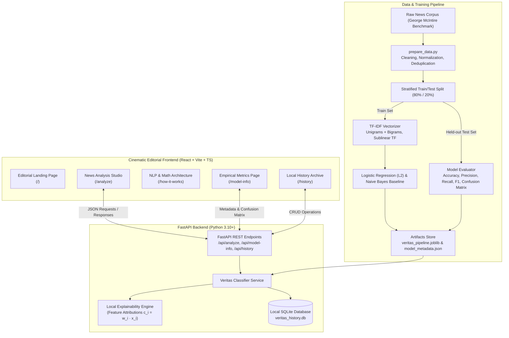

# VERITAS AI — Look Beyond the Headline
### Supervised Natural Language Processing & News Credibility Research System

[](https://github.com)
[](https://github.com)
[](https://github.com)
[](https://fastapi.tiangolo.com)
[](https://vitejs.dev)

---

## 1. Project Overview & Scientific Purpose

**VERITAS AI** is an educational, full-stack Natural Language Processing (NLP) system designed to explore supervised text classification on news articles. Combining modern web engineering with genuine statistical machine learning, the system extracts n-gram Term Frequency-Inverse Document Frequency (TF-IDF) feature representations, predicts publication patterns using an L2-regularized Logistic Regression classifier, and exposes feature-level local attribution ($c_i = w_i \cdot x_i$) to explain model predictions to users and researchers.

### The Scientific Boundary & Limitation

> [!IMPORTANT]
> **CRITICAL SCIENTIFIC & ETHICAL LIMITATION**  
> VERITAS AI is a supervised statistical classifier trained on patterns observed in a historical news corpus. **It does NOT independently verify physical reality, check live external facts, consult intelligence databases, or determine ontological truth.**
>
> When the system predicts a label, it is reporting that the document's vocabulary and n-gram distribution mathematically resembles articles in the labeled training distribution. All outputs must be treated as probabilistic pattern assessments and independently verified against trustworthy journalistic sources.

Predictions are scientifically phrased as:
- **Model classified as Real**: Vocabulary aligns with reputable journalistic patterns.
- **Model classified as Fake**: Vocabulary aligns with fabricated or sensationalist patterns.
- **Model could not produce a reliable classification**: Prediction margin lies within the boundary of uncertainty.

---

## 2. System Architecture



---

## 3. Technology Stack

### Machine Learning & NLP
- **Language**: Python 3.10+
- **Feature Extraction**: `scikit-learn` `TfidfVectorizer` (unigrams + bigrams, sublinear term frequency scaling, smooth IDF, L2 normalization)
- **Primary Model**: `LogisticRegression` (L2 regularization, L-BFGS numerical solver, balanced class weights)
- **Baseline Model**: `MultinomialNB` ($\alpha=0.1$) for empirical validation of linear boundaries
- **Serialization**: `joblib` end-to-end scikit-learn `Pipeline`

### Backend Service
- **Framework**: FastAPI 0.115+
- **Validation**: Pydantic v2 (min/max character validation, whitespace sanitization)
- **Storage**: Local embedded SQLite (`artifacts/veritas_history.db`) for private, client-controlled history
- **Server**: Uvicorn with ASGI architecture
- **Testing**: Pytest (17 comprehensive unit & integration tests)

### Cinematic Editorial Frontend
- **Framework**: React 19 + TypeScript
- **Bundler**: Vite 8 with Tailwind CSS v4
- **Icons**: Lucide React
- **Routing**: React Router v7
- **Aesthetics**: Editorial typography (`Newsreader` serif, `Cinzel` display, `JetBrains Mono`), deep obsidian palette (`#0b0c0e`), warm ivory accents (`#fcfaf7`), muted crimson alerts (`#b91c1c`), subtle gold highlights (`#d97706`).

---

## 4. Machine Learning Formulation & Mathematics

### A. Sublinear TF-IDF Feature Extraction
Standard term frequency gives linear weight to repeated occurrences. VERITAS AI uses **sublinear term frequency scaling** to prevent excessive term saturation:

$$\text{tf}_{\text{sublinear}}(t, d) = \begin{cases} 1 + \log(\text{tf}(t, d)) & \text{if } \text{tf}(t, d) > 0 \\ 0 & \text{otherwise} \end{cases}$$

Inverse Document Frequency (IDF) scales down ubiquitous terms across all documents:

$$\text{idf}(t) = \log\left(\frac{1 + N}{1 + \text{df}(t)}\right) + 1$$

Vectors are then Euclidean ($L_2$) normalized to unit length:

$$\mathbf{x} = \frac{\mathbf{v}}{\|\mathbf{v}\|_2}$$

### B. Regularized Logistic Regression Classifier
The decision score $z$ is a linear combination of token weights:

$$z = w_0 + \sum_{i=1}^{V} w_i \cdot x_i$$

The posterior probability that the article reflects fabricated training patterns is computed via the logistic sigmoid function:

$$P(y = \text{FAKE} \mid \mathbf{x}; \mathbf{w}) = \sigma(z) = \frac{1}{1 + e^{-z}}$$

With an L2 weight penalty added to the cross-entropy objective:

$$\min_{\mathbf{w}} \left( -\frac{1}{N}\sum_{j=1}^N \Big[y_j \log \sigma(z_j) + (1 - y_j)\log(1 - \sigma(z_j))\Big] + \frac{1}{2C} \|\mathbf{w}\|_2^2 \right)$$

### C. Feature Attribution & Local Explainability
For any evaluated document, the exact contribution $c_i$ of vocabulary token $i$ is:

$$c_i = w_i \cdot x_i$$

- **$c_i > 0$**: The presence and frequency of this n-gram shifts the linear score toward the **FAKE** class.
- **$c_i < 0$**: The presence and frequency of this n-gram shifts the linear score toward the **REAL** class.

---

## 5. Held-Out Evaluation Metrics

Evaluated on **1,253 held-out test articles** (20% stratified split, seed=42) after training strictly on 5,008 training articles:

| Metric | Primary Model (TF-IDF + LogReg) | Baseline (TF-IDF + Naive Bayes) |
|---|---|---|
| **Test Accuracy** | **93.93%** | 91.94% |
| **Macro Precision** | **93.96%** | 91.94% |
| **Macro Recall** | **93.94%** | 91.94% |
| **Macro F1 Score** | **0.9393** | 0.9194% |

### Held-Out Confusion Matrix
- **True Negatives (TN - Actual REAL, Predicted REAL)**: 585
- **False Positives (FP - Actual REAL, Predicted FAKE)**: 46
- **False Negatives (FN - Actual FAKE, Predicted REAL)**: 30
- **True Positives (TP - Actual FAKE, Predicted FAKE)**: 592

---

## 6. Project Directory Structure

```text
veritas-ai/
│
├── backend/
│   ├── app/
│   │   ├── api/
│   │   │   └── routes.py           # FastAPI REST routes (/analyze, /model-info, /history)
│   │   ├── schemas/
│   │   │   └── news.py             # Pydantic request, response, and metadata models
│   │   ├── services/
│   │   │   ├── classifier.py       # Inference manager and scientific safety wrapper
│   │   │   ├── explainer.py        # Local feature attribution (w_i · x_i)
│   │   │   └── history_db.py       # Local SQLite persistence engine
│   │   └── main.py                 # FastAPI application entrypoint & CORS config
│   │
│   ├── data/
│   │   ├── news_dataset.csv        # Cleaned, validated benchmark dataset
│   │   └── sample_articles.json    # Illustrative test articles for UI prefilling
│   │
│   ├── artifacts/
│   │   ├── veritas_pipeline.joblib # Fitted Scikit-Learn TF-IDF + LogReg pipeline
│   │   ├── model_metadata.json     # Empirical metrics, parameters, and vocabulary
│   │   ├── evaluation_results.json # Held-out evaluation summary
│   │   └── veritas_history.db      # Local SQLite database
│   │
│   ├── scripts/
│   │   ├── prepare_data.py         # Benchmark downloading, cleaning, deduplication
│   │   └── train.py                # Stratified training, evaluation, and serialization
│   │
│   ├── tests/
│   │   ├── test_preprocessing_and_dataset.py  # Unit tests for data cleaning & schema
│   │   ├── test_pipeline_and_training.py      # Unit tests for TF-IDF pipeline & metrics
│   │   └── test_api_and_inference.py          # Integration tests for FastAPI endpoints
│   │
│   └── requirements.txt            # Python dependencies
│
├── frontend/
│   ├── src/
│   │   ├── components/
│   │   │   ├── Navbar.tsx                   # Editorial topbar with live model status
│   │   │   ├── Footer.tsx                   # Academic attribution & limitation banners
│   │   │   ├── PredictionCard.tsx           # Prediction display with probability gauge
│   │   │   ├── FeatureExplainabilityCard.tsx# Token attribution chips and math explanation
│   │   │   └── SampleArticleSelector.tsx    # One-click illustrative story loader
│   │   │
│   │   ├── pages/
│   │   │   ├── HomePage.tsx                 # Hero, live metrics, and pipeline pillars
│   │   │   ├── AnalyzePage.tsx              # Analysis studio with real-time counters
│   │   │   ├── HowItWorksPage.tsx           # In-depth math & NLP walkthrough
│   │   │   ├── ModelInfoPage.tsx            # Live empirical evaluation & confusion matrix
│   │   │   └── HistoryPage.tsx              # Private local SQLite history viewer
│   │   │
│   │   ├── services/
│   │   │   └── api.ts                       # Typed frontend fetch client
│   │   │
│   │   ├── types/
│   │   │   └── index.ts                     # TypeScript interfaces
│   │   │
│   │   ├── App.tsx                          # React Router definitions
│   │   ├── main.tsx                         # React entrypoint
│   │   └── index.css                        # Tailwind v4 & typography layers
│   │
│   ├── package.json
│   └── vite.config.ts                       # Vite config with proxy to :8000
│
├── README.md                                # Comprehensive documentation
└── .gitignore                               # Git ignore configuration
```

---

## 7. Windows PowerShell Execution Guide

Follow these exact steps to run VERITAS AI on Windows using PowerShell:

### Step 1: Open PowerShell and Navigate to the Project Root
```powershell
cd C:\Users\Admin\.gemini\antigravity\scratch\veritas-ai
```

### Step 2: Set Up Python Virtual Environment (Optional but Recommended)
```powershell
python -m venv .venv
.\.venv\Scripts\Activate.ps1
```

### Step 3: Install Backend Dependencies
```powershell
pip install -r backend/requirements.txt
```

### Step 4: Prepare the Benchmark Dataset
```powershell
python backend/scripts/prepare_data.py
```
*Downloads the George McIntire benchmark dataset, validates columns, removes duplicate records, normalizes labels, and generates illustrative sample stories.*

### Step 5: Train and Evaluate the Model
```powershell
python backend/scripts/train.py
```
*Executes a stratified 80/20 train/test split, fits the TF-IDF vectorizer strictly on training data, evaluates Logistic Regression and the Naive Bayes baseline on held-out test data, and saves `veritas_pipeline.joblib` and `model_metadata.json`.*

### Step 6: Run Automated Backend Tests
```powershell
python -m pytest backend/tests -v
```
*Executes all 17 unit and integration tests (validation, bounds checking, model inference, explainability, and history persistence).*

### Step 7: Launch the FastAPI Backend Server
```powershell
# In a PowerShell terminal:
python -m uvicorn backend.app.main:app --host 127.0.0.1 --port 8000 --reload
```
*Backend is now running at `http://127.0.0.1:8000` (Interactive API docs at `http://127.0.0.1:8000/docs`).*

### Step 8: Launch the React Vite Frontend
Open a **second** PowerShell terminal:
```powershell
cd C:\Users\Admin\.gemini\antigravity\scratch\veritas-ai\frontend
npm install
npm run dev
```
*Frontend will launch at `http://localhost:5173` with automatic reverse-proxying of `/api/*` to the FastAPI backend at port 8000.*

---

## 8. API Documentation

| Method | Endpoint | Description |
|---|---|---|
| `GET` | `/api/health` | Operational health and model load condition |
| `GET` | `/api/model-info` | Real held-out evaluation metrics, dataset metadata, and confusion matrix |
| `GET` | `/api/samples` | Curated illustrative sample news articles across various domains |
| `POST` | `/api/analyze` | Supervised NLP prediction with posterior probabilities and feature attributions |
| `GET` | `/api/history` | List recent local analysis records (stored in SQLite) |
| `GET` | `/api/history/{id}` | Retrieve complete archived prediction details by record ID |
| `DELETE`| `/api/history/{id}` | Permanently delete an individual history record |
| `DELETE`| `/api/history` | Clear all analysis records from local storage |

### Sample `POST /api/analyze` Request Body:
```json
{
  "headline": "Federal Reserve Holds Benchmark Interest Rate Steady",
  "article_text": "The Federal Reserve on Wednesday held its benchmark interest rate unchanged in a targeted range of 5.25% to 5.50%, noting that economic activity has been expanding at a solid pace and job gains have remained robust. Federal Reserve officials noted that while headline inflation metrics have cooled considerably, monetary policymakers require additional empirical evidence before rate reductions."
}
```

---

## 9. Git Repository Management

To initialize and prepare this repository for GitHub:

```powershell
# Navigate to project root
cd C:\Users\Admin\.gemini\antigravity\scratch\veritas-ai

# Initialize Git
git init

# Add all files (respecting .gitignore)
git add .

# Commit project
git commit -m "feat: complete functional VERITAS AI news classification system with empirical training"

# Connect remote (replace with your repository URL)
# git remote add origin https://github.com/<your-username>/veritas-ai.git
# git branch -M main
# git push -u origin main
```

*(Note: Per user instructions, Git commits and pushes will not be executed without explicit permission).*

---

## 10. Student & Author Attribution

- **Project**: VERITAS AI (Project 24)
- **Category**: Natural Language Processing & Machine Learning
- **Specialization**: B.Tech / B.E. Computer Science Engineering (Artificial Intelligence & Machine Learning), 3rd Year
- **Academic Purpose**: Level 2 Portfolio Showcase demonstrating sound machine learning principles (stratified splitting, leakage prevention, explainability, empirical evaluation) coupled with modern full-stack web software architecture.
